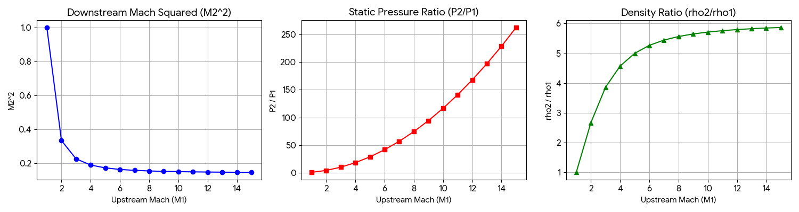

# Normal Shock Relations Analysis

This section visualizes the fundamental property jumps across a normal shock wave ($\gamma = 1.4$), mapping the analytical relations from $M_1 = 1.0$ to $M_1 = 15.0$. 

## Data Overview
The dataset `Normal Shock Relation.xlsx` contains three primary evaluations:
*   **Sheet 1:** Downstream Mach number squared ($M_2^2$). Shows the asymptotic limit as $M_1 \to \infty$.
*   **Sheet 2:** Static pressure ratio ($P_2/P_1$). Demonstrates the steep, continuous quadratic rise in pressure.
*   **Sheet 3:** Density ratio ($\rho_2/\rho_1$). Illustrates the physical maximum density compression limit (which caps at 6 for air).

## Visualizations

